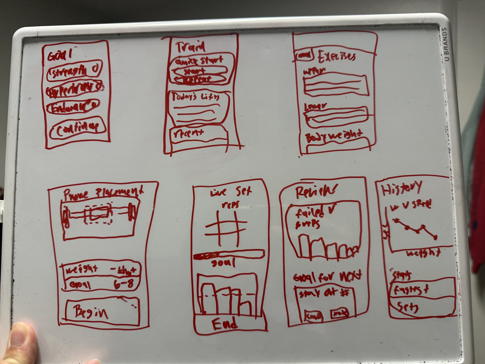

# Concentric

A React Native app built with Expo that uses your phone's motion sensors to measure every rep and check whether you actually trained to failure.

**Designed for iPhone.**

## About

- Built around Mike Mentzer's Heavy Duty style of training: one all-out set per exercise, taken to true failure
- Strap your phone to your forearm (or chest for bodyweight lifts) and lift; Concentric counts reps and measures how fast each one moves
- Every set ends with one of three results:
  - **Verified failure**: a rep started up, stalled short of the range of motion of earlier reps, and came back down
  - **Near failure**: your last rep was right at the slowest speed you can still complete a rep at
  - **Stopped short**: your last rep was still fast, with an estimate of how many reps you had left
- Your goal (strength, hypertrophy or endurance) sets the rep range you should fail in, and Concentric tells you whether to add weight, stay, or drop weight next time
- Tracks how long your negatives take, since Mentzer emphasized slow eccentrics

## Screens

- **Your Goal** (first launch): pick Strength (3–6), Hypertrophy (6–12) or Endurance (15+), and training style toggles
- **Train**: start a set, repeat your last workout, today's plan and recent sessions
- **Choose Exercise**: search, filter by Barbell / Body / Machine, and see your last result for each lift
- **Placement**: where to put your phone, the weight (pre-filled from your last set), and a safety reminder for squat and bench
- **Live Set**: mount your phone, hold still while it calibrates, then lift
  - Large rep count and last-rep speed you can read from the rack
  - Goal range meter and a bar for every rep, with the failure zone shaded
  - A haptic tap on every rep and a stronger buzz when a rep fails, so you never need to look at the screen
  - If you end the set while your reps are still fast, it tells you that you have more in you
- **Set Summary**: the result, average and last-rep speed, negatives, the rep chart and a "Next time" recommendation
- **Progress**: weight vs. speed for each set, an estimated one-rep max, and your bests
- **Library**: every exercise with its recent sets and setup
- **Settings**: goal, units (lb or kg), bodyweight, haptics, demo mode, and a developer screen for recording sensor data

## How a Rep Is Measured

- Reads `DeviceMotion` at 100 Hz (gravity is already removed from the acceleration)
- Projects acceleration onto the direction of gravity, so the angle of the phone in the armband doesn't matter
- Integrates acceleration into velocity, and resets velocity to zero whenever the phone is still or the lift turns around, so sensor drift can't build up
- Splits the movement into up and down phases, and measures each rep's mean speed, peak speed, range of motion and negative time
- A rep that covers less than 70% of the range of your earlier reps is flagged as a failed rep
- All of this lives in `src/engine/` as plain TypeScript with no React Native imports, so it runs the same on the phone, in tests and in the analysis script

## Demo Mode

- Turn on **Settings → Demo mode** to try a set without lifting
- Tapping Begin replays a recorded set through the exact same rep detection the real sensors use
  - Barbell and machine lifts replay a squat set that ends in a failed rep
  - Bodyweight lifts replay a pull-up set that stops short
- With demo mode off, Live Set uses your phone's sensors

## Requirements

- **Reusable components**: screens are built from shared components in `src/components/` (`Section`, `ListRow`, `SegmentedControl`, `StepperRow`, `RepBarChart`, `GoalRangeMeter`, `ScatterChart`, `MountIllustration`, `Callout`, and more)
- **Context**: `SettingsContext` shares the goal, units, bodyweight, haptics and demo mode across the app; everything else is passed through props and route params
- **Local storage**: settings are saved with `expo-sqlite/kv-store`; recorded sensor data is saved as JSON with `expo-file-system`
- **Device functionality**: motion sensors (`expo-sensors`), haptics (`expo-haptics`), and keeping the screen awake during a set (`expo-keep-awake`)
- **Professional look**: one set of color, type and spacing tokens in `src/theme/theme.ts`, light and dark mode, and SF Symbols

## Wireframes

Goal, Train, Exercises, Phone Placement, Live Set, Review and History

Changes since the wireframes:

- Exercises are filtered by Barbell / Body / Machine with a search field, instead of Upper / Lower / Bodyweight sections
- Begin and calibration moved from Phone Placement to the start of Live Set, since strapping the phone on after calibrating would throw it off
- Review became Set Summary, and History became the Progress tab, which adds an estimated one-rep max
- Added a "stopped short" prompt to Live Set for when you end a set while your reps are still fast
- Added Library and Settings tabs, which weren't in the sketches
- Weights are in pounds by default, with a kilogram option in Settings
- Bodyweight lifts use a chest or upper-arm mount, since your forearms barely move when your hands are on the bar or the floor

## Human Interface Guidelines

### Navigation & Flow

The tab bar only holds the four top-level areas (Train, Progress, Library and Settings), and each tab uses a large title. Doing a set is a focused task, so it opens as a sheet over the tabs instead of living in one of them. You can swipe the sheet away or go back while you're picking an exercise and setting up, but once you tap Begin the sheet locks, and leaving asks you to confirm so a bump at the rack can't throw away your set. Editing your goal opens as its own sheet with a Save button.

### Feedback Without Looking

Your phone is strapped to your arm during a set, so haptics are the main feedback: a tap on every rep, a success buzz when calibration finishes, and an error buzz when a rep fails. The rep count is 128 points and the speed is 34 points, so both can be read at arm's length. The result of a set is never shown by color alone. Verified failure, near failure and stopped short each have their own icon, title and sentence, and the failure zone on the chart is labeled in text as well as shaded.

### Layout & Accessibility

I used inset grouped lists with standard 16 point margins and section headers, segmented controls for small sets of choices, and a stepper for weight. Buttons, list rows and option chips are at least 44 points tall. Charts have VoiceOver labels that read out each rep's speed, the steppers can be adjusted with the VoiceOver swipe gestures, and icon-only buttons are labeled. Dark mode has its own colors instead of an inverted version of light mode, and the Motion & Fitness permission is only requested when you tap Begin for the first time.

## Extra Packages

- **`expo-sensors`**: `DeviceMotion` for acceleration, gravity and rotation rate
- **`expo-haptics`**: rep, success and failure feedback
- **`expo-keep-awake`**: keeps the screen on during a set
- **`expo-sqlite`**: key-value storage for settings
- **`expo-file-system`** and **`expo-sharing`**: saving and sharing recorded sensor data
- **`react-native-svg`**: rep bars, the live acceleration chart, the progress scatter plot and the placement illustrations
- **`expo-symbols`**: SF Symbols on iOS and Material Symbols on Android

## Project Status

First submission. Working now:

- Every screen from the wireframes, plus Library, Settings and exercise detail
- Live rep detection from the phone's sensors, failure detection, and the three set results
- Demo mode
- Next-weight recommendations and the estimated one-rep max

Still to come:

- Saving sets to SQLite. History, Recent and Progress currently show sample data
- Tuning the detection thresholds on real gym recordings (the current values are starting points from velocity-based training research)
- Unit tests for `src/engine/` using recorded sets
- Testing the weight-stack mount on machines, plus an app icon and splash screen

## Developer Tools

- **Settings → Developer → Record Trace** records raw sensor data from a set and shares it as JSON
- `npm run analyze -- <trace.json>` prints each detected rep and writes a chart report to `analysis/`
- `npm run synthetic` regenerates the demo sets in `assets/traces/`

## Running It

1. `npm install`
2. `npx expo start`
3. Scan the QR code with your iPhone's camera to open it in Expo Go

Requires Expo Go for SDK 58. The sensors only work on a real phone; on a simulator, turn on demo mode.
